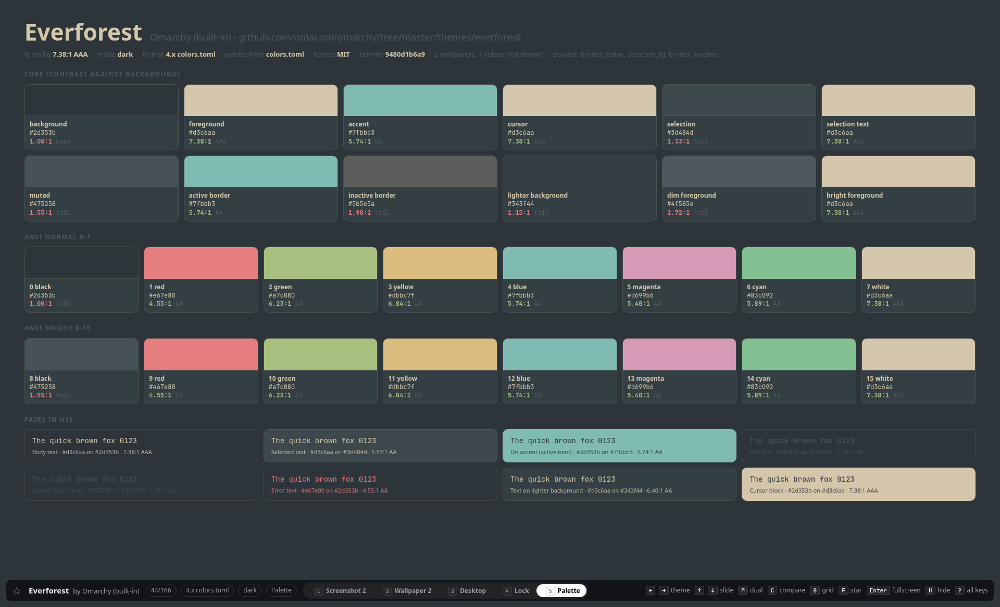

# awesome-omarchy-themes

Browse, compare and rank Omarchy desktop themes in a local gallery with palette previews, filters and interactive statistics.

## Screenshots

The gallery's own palette and contrast view:



## Quick start

Install Python 3.11 or newer and Git, then clone and build:

```sh
git clone https://github.com/kvnloo/awesome-omarchy-themes.git
cd awesome-omarchy-themes
python3 tools/build.py all --cache-max-mb 20000
```

Open `app/index.html` in your browser. The build fetches themes from their authors' repositories; the generated app works offline from `file://` with no server or network requests.

Python's standard library is enough. Pillow optionally generates thumbnails and smaller display images; ImageMagick or ffmpeg can also resize them. Without an image backend, the browser displays local originals.

Themes, wallpapers and screenshots belong to their authors. They are fetched from their repositories at build time into a git-ignored cache, not redistributed in this repository. See each theme's licence for its terms.

## Build commands

`tools/build.py` is the single entry point. Its functions can also be imported
without running the CLI.

| Command | Result |
| --- | --- |
| `list` | Shallow-clone or update `omacom/omarchy-site` and `omacom/omarchy`; write the catalog to the cache |
| `discover` | Enumerate curated lists and, with a token, probe GitHub search candidates |
| `stats` | Cache GitHub stars, forks, dates, issues and archive status |
| `fetch` | Select and shallow-clone community themes; select built-in themes from the cached Omarchy tree |
| `palettes` | Read the fetch receipt; write palette, provenance and image job metadata to the cache |
| `images` | Copy chosen images and generate optional thumbnails in `app/img/` |
| `data` | Write the gallery's local `app/data.js` script |
| `check` | Fail if a referenced image is missing or non-local, or an app HTML/CSS/JS source contains an HTTP(S) URL |
| `all` | Run list, discover, stats, fetch, palettes, images, data and check, in order |

The cache defaults to `./cache`, relative to your current directory. Set
`THEME_GALLERY_CACHE` or pass `--cache DIR` before or after the command.
Output defaults to this repository's `app/`. Pass `--output DIR` to write a complete
gallery elsewhere. Every browser image reference lives in
`app/img/`, so the gallery works with caches in other locations.

The first `list` downloads about 900 MB of catalogue repositories.

`fetch` and `all` accept `--only slug,slug`, `--limit N`, `--max-mb 150`, and
`--jobs 6`. Selection applies to built-ins and community themes, then the limit
applies in catalog order. Unknown slugs are errors. Only the selected themes
appear in the fetch receipt and subsequent gallery, even if older themes remain
cached. Built-ins come from the required Omarchy catalog clone; they do not each
need a separate clone.

The per-theme cap measures working-tree bytes in MiB, excluding `.git` and
symlinks. Oversized community clones are removed after cloning. This cap does
not bound the network transfer or Git metadata. Community clones have a
60-second timeout; catalogue clones and updates have a 900-second timeout;
community fetching also skips new work when the theme cache exceeds
`--cache-max-mb` MiB, which defaults to 6,000. Increase this for larger tiers.
Previously fetched community repositories are reused; `list` updates the two
catalog repositories. Failed or oversized themes are recorded as skipped. A
fetch with no successful themes fails.

The default cache, `app/data.js`, and `app/img/` are git-ignored. If you choose a
custom cache inside this repository, add that directory to `.gitignore` before
staging anything. Theme repositories and generated files are not included here.

## Sources, tiers and statistics

The default `curated` tier adds the manual, both awesome-omarchy lists and
omarchytheme.com to the built-ins and official list. Source memberships are
merged by canonical repository identity. Themes must pass a palette and layout
acceptance test. Every theme is retained, including identical palettes. Lower-priority
palette twins carry a "same palette as X" badge, favouring built-in, official and
curated entries, then the most-starred and oldest repository. The Twins chip starts
with twins shown; toggle it to hide them, or type `twins:hide`.

| Tier | Contents | Earlier theme estimate | Estimated full-clone size |
| --- | --- | --- | --- |
| `official` | Built-ins and official list | 166 | 4.9 GB |
| `curated` | Official plus four curated sources | 420 | 12.8 GB |
| `starred` | Curated plus search results with at least `--min-stars` stars | 630 | 23 GB |
| `all` | Every accepted search result | 2,150 | 54 GB |

These earlier estimates excluded palette twins and applied the per-theme cap.
Current builds retain twins, so totals can be higher. New community sources use
lean, sparse clones. `--wallpapers N` limits their copied
wallpapers to six by default; zero keeps all. The catalog still records their
full wallpaper, video and application counts. Official themes keep all images.

```sh
python3 tools/build.py all --tier curated --cache-max-mb 20000
python3 tools/build.py all --tier starred --min-stars 2 --wallpapers 6
python3 tools/build.py stats --refresh-stats
python3 tools/build.py data
python3 tools/build.py all --cache /path/to/cache --output /path/to/gallery
```

Tokens are resolved from `GITHUB_TOKEN`, `GH_TOKEN`, then `gh auth token`.
The token stays in memory and is sent in the GitHub authorization header; it is
never written to the gallery or cache. Authorization-bearing requests refuse
redirects. Official slugs retain the list identity; other slugs follow the first
queried repository URL, so API renames do not change favourites or links.
Stats are cached with their fetch date for `--stats-max-age` days, seven by
default. `--refresh-stats` forces a refresh.
`stats` followed by `data` updates rankings without re-cloning themes.
`--no-api` disables API use; `--no-search` skips repository search. A missing
token falls back from `starred` or `all` to `curated`. Failed statistics requests
produce an empty stats cache and the gallery remains usable.

## Rankings, filters and charts

Popularity is the default. With GitHub statistics, the score is:

```text
100 × (0.70 × stars + 0.05 × forks + 0.10 × lists + 0.15 × recency)
stars   = min(1, ln(1 + star count) / ln(151))
forks   = min(1, ln(1 + fork count) / ln(21))
lists   = min(1, (2 × official membership + curated list count) / 6)
recency = 0.5 ^ (months since last push / 6)
```

The cache's statistics date anchors recency, with months measured as 30.44 days. Stars carry most of the weight; card tooltips show stars, forks, lists and last push. Press I for the weighted score breakdown. With no token or statistics, popularity uses `100 × (0.6 × lists + 0.4 × commit recency)` and star-dependent controls disappear.

Built-ins have no repository statistics. Popularity, Stars, Trending, Newest and Recently updated put them in a separate collapsible "Built into Omarchy" section, with no score or rank. Its open state is remembered. Community ranks start at 1. Built-ins participate normally in all palette, completeness, wallpaper, name and hue rankings.

Trending divides stars plus one by repository age in months plus three. Newest uses creation dates; Recently updated uses the last push or cached commit date. Completeness measures authored palette keys, app coverage, previews, wallpapers and licensing. Wallpapers sorts by count and uses resolution to break ties. Legibility measures the worst foreground or terminal colour contrast against the background. Colourfulness measures mean OKLCH chroma; Uniqueness measures distance to the nearest palette. Name and Accent hue provide plain ordering. Missing values stay below the No data divider, including in reverse order. Ties break by display name, then slug.

Filter kinds combine with AND, and values within a kind combine with OR. Filter
by mode, accent family, background lightness, contrast, terminal legibility,
format, licence, source tier, video, wallpaper count, stars, update window,
author or favourites. Similarity shows the current palette and its 24 nearest
neighbours. Colour matching uses OKLab distance to accents and terminal colours, keeps
matches within 8 distance units, and caps the result at the 48 nearest themes.
If fewer than twelve match, it shows the best twelve from the filtered set.

Type filters directly into search, for example:

```text
mode:light hue:blue,purple con:aa
stars:10 since:90d sort:trend
like:tokyo-night
col:ff79c6
```

Unknown filter words remain ordinary search text. Active filters are removable,
and the hash stores their state, for example
`#tokyo-night/mock?view=grid&sort=trend&mode=dark&hue=blue,purple`.
Prefix the ranking with `-` to reverse it. Old `sort=contrast` links map to
Legibility, and `sort=format` maps to Name.

The Stats view follows the same filters. It includes summary numbers, a hue
wheel, a palette quilt with a true-position toggle, background lightness against
text contrast, the current ranking's leaderboard, monthly publication counts,
six terminal colour histograms and every accent name in the selection. Built-ins
are left out of repository-based leaderboards and outlined in the compact palette quilt. The True positions toggle restores PCA coordinates and enables region brushing. Click quilt tiles to open individual themes.
Marks have hover and focus tooltips; click a theme to open it, or click an aggregate or brush a region to
filter the gallery. Every card has a table fallback. Monthly counts require
GitHub statistics. PCA coordinates and ranking metrics are computed at build time. The quilt packs
the current selection locally; charts bin and count that same filtered slice.

## Keys

| Key | Action |
| --- | --- |
| Right / J / Page Down; Left / K / Page Up | Next; previous theme, following the grid's filter and sort |
| Down / Up; Space / Shift+Space | Next; previous slide |
| 1 / 2 / 3 / 4 / 5 | Screenshot / wallpaper / mock desktop / lock / palette; repeat 1 or 2 to advance that kind |
| W / Shift+W | Next / previous wallpaper, including behind the mock desktop |
| L | Toggle the launcher's and notifications' mock overlays |
| M | Toggle landscape plus portrait dual-monitor view |
| C | Cycle comparison with the previously viewed theme: split, mouse-controlled wipe, off |
| X | Swap compared themes |
| G / Esc | Open the grid; Esc closes it or first clears its search |
| F | Star or unstar the current theme |
| S | Open the starred slug list for copying or downloading |
| Enter / F11 | Browser fullscreen; Enter opens the selected theme in the grid |
| O | Open the current original screenshot or wallpaper in a new tab |
| R | Random theme |
| Home / End | First / last filtered theme |
| H | Hide or show the HUD |
| V | Toggle Stats from fullscreen |
| T / Shift+T | Next / previous ranking from fullscreen |
| A | Show the current palette and its nearest neighbours |
| E | Match a hex colour |
| I | Toggle theme information and score details |
| 0 | Clear all filters |
| ? | Help |

In the grid, type to search and use arrows and Enter to select. Tab follows the
filter controls. In Stats, Tab and arrows navigate charts and marks, Enter opens
a theme or applies a selection, T toggles the table, and Escape closes Stats.
On the leaderboard, T cycles rankings and Shift+T toggles its table. V also
closes Stats. Esc closes
modals. Wheel, horizontal swipes and screen edges change themes; Shift+wheel
and vertical swipes change slides. Clicking a palette swatch copies its hex
colour. Favourites and HUD visibility use localStorage when available.

## Theme data and extraction

Theme repositories are fetched as data, never executed, sourced or installed.
Git hooks, checkout symlinks, LFS smudge/process filters and recursive submodules
are disabled. Git system and global configuration are ignored for build Git
commands. The parser reads known colour files; it does not load theme shell,
Python, Lua, JavaScript, extensions or application configuration as code.

Palette files fill gaps in this exact order: `colors.toml`, `alacritty.toml`,
`kitty.conf`, `ghostty.conf`, `hyprland.conf`. Hyprland supplies border colours
only. Omarchy 4.x named colours follow its Alacritty template: black is the
background, white the foreground, bright black muted, and bright white
`bright_foreground`. Named values win over `color0` through `color15`.
Missing core colours use the original fallbacks; secondary colours retain the
original mix and contrast rules. The cache records source files, guessed and
derived fields, repository commits, detected licences and skipped themes.

Image selection also follows the original pipeline. Prefer `preview.png` and
then `preview-unlock.png`. Otherwise look for screenshot-like names at the root
and images larger than 30,000 bytes in the known preview/media/docs directories.
Prefer non-logo/non-palette candidates and larger files, keeping up to three.
Only when no repository preview exists, use its cached Omarchy site image.
Wallpapers come from `backgrounds/`, in directory and filename order. Video
files are noted, never copied into the app. Originals and display copies stay
local; repository URLs in `data.js` are attribution metadata. `check` scans app
source files for HTTP(S) URLs and validates image URLs in generated data.

## Limits and verification

The mock desktop is an approximation. It cannot reproduce each theme's real
application settings, font choices, extensions or window manager behaviour.
Preview verification is limited to static rendering; this project does not
install or test desktop themes. Optional decoders and browser image support can
differ, and individual theme fetches or image decodes may fail.

Run the offline tests without fetching any themes:

```sh
python3 -m unittest discover -s tests -v
```

CI runs these tests on Python 3.11 and 3.13 for pushes and pull requests. It does
not deploy the gallery or fetch theme repositories.

To verify a cached build with GitHub statistics in headless Chromium, use
Node.js with the built-in WebSocket API and `/usr/bin/chromium`:

```sh
TMPDIR=/path/to/build/_check/tmp node tools/check_polish.mjs /path/to/build
```

The build directory must contain `app/`. The script checks rankings, controls,
charts and mobile layout, then writes 1920×1080 screenshots and a JSON report
under `_check/polish/`. It blocks external hosts and keeps its browser profile
in `TMPDIR`.

## Credits

Thanks to [Omarchy](https://github.com/omacom/omarchy) and the theme authors.
The catalog comes from [Omarchy's official theme list](https://omarchy.org/themes/)
and [its site repository](https://github.com/omacom/omarchy-site). Theme names,
authors, repository links and source revisions are retained in generated data.

## Licence and theme ownership

The gallery code is [MIT licensed](LICENSE). Themes, wallpapers and screenshots belong to their authors. The build downloads
them into a git-ignored cache and creates local, git-ignored image copies for
viewing. They are not redistributed in this repository and are not covered by
this repository's MIT licence. Refer to each theme's own licence and author for
its terms. The documentation PNG is a capture of this gallery's own palette UI,
not a theme author's screenshot or wallpaper.
